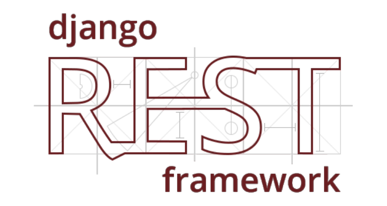
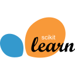
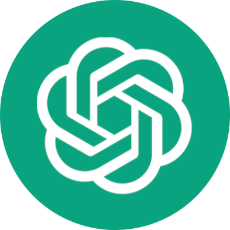
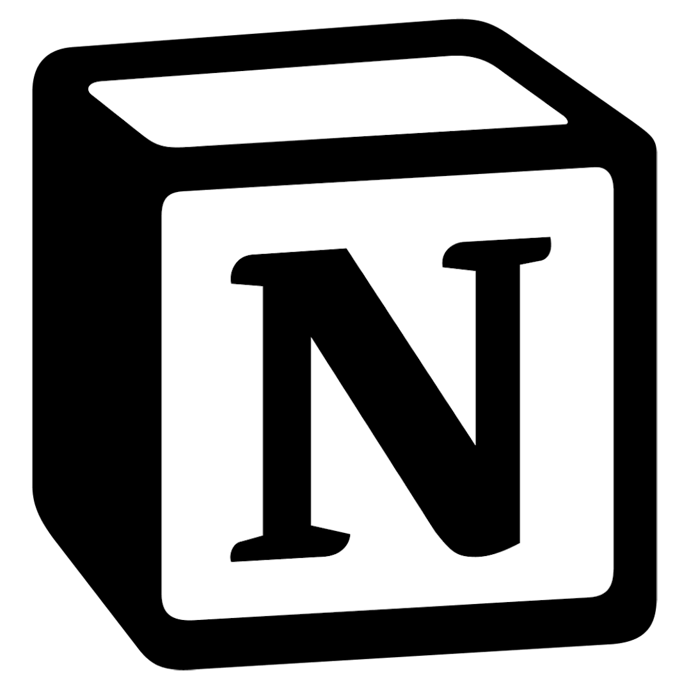

<table>
  <tr>
    <td width="60%" valign="top">
        <h1>¡Hola! Soy Javier 👋</h1>
        <h3>Junior Developer · Python &amp; AI · Backend · DAM &amp; DAW</h3>
  

    Llevo más de tres años desarrollando proyectos para clientes con WordPress, siempre con un objetivo claro, que el proyecto convierta. Ahí aprendí a trabajar mano a mano con el cliente, a convertir requisitos difusos en soluciones concretas y a explicar lo técnico en el idioma del negocio.
  

  

    Ahora estoy centrado en el <strong>desarrollo web con JavaScript, PHP y MySQL</strong>, que estudio en el Certificado de Profesionalidad en Desarrollo de Aplicaciones Web (DAW), junto al Grado Superior en Desarrollo de Aplicaciones Multiplataforma (DAM). Como complemento, me formo en <strong>Python e IA</strong>. Mi última etapa, como Junior Full Stack Web Developer en remoto (voluntariado), me sirvió para dar el salto del CMS al código: mantenimiento de aplicaciones web en producción, nuevas funcionalidades y corrección de errores.
  

  
  <h4>💻 Me estoy formando en</h4>
  <ul>
    <li><strong>Python Developer + IA</strong> (Machine Learning y Deep Learning), Escuela MUSK (2026–2027)</li>
    <li><strong>Técnico Superior en Desarrollo de Aplicaciones Multiplataforma (DAM)</strong>, Explora (2026–2028)</li>
    <li><strong>Certificado de Profesionalidad en Desarrollo de Aplicaciones Web (DAW)</strong>, Acción Laboral (septiembre 2026 – febrero 2027)</li>
  </ul>
  
  <h4>🎯 Objetivos para este año</h4>
  

    Obtener la certificación <strong>PCAP (Certified Associate Python Programmer)</strong> del Python Institute, completar el Certificado de Profesionalidad en DAW con sus prácticas en empresa, avanzar en el Grado Superior en DAM y consolidar lo aprendido con proyectos reales de IA y análisis de datos.
  

    </td>
    <td width="40%" align="center" valign="middle">
      
    </td>
  </tr>
</table>

---

## 🛠️ Tecnologías y Herramientas

### 💻 Desarrollo Web y Diseño (Core)

  &nbsp;
  &nbsp;
  &nbsp;
  &nbsp;
  &nbsp;
  &nbsp;
  

### 🐍 Especialización Actual: Python & Data Backend
*Herramientas y frameworks que estoy implementando activamente en mis proyectos de formación:*

  &nbsp;
  &nbsp;
  &nbsp;
  &nbsp;
  &nbsp;
  

### 📊 En Formación Avanzada: Ciencia de Datos e IA
*Tecnologías en las que me estoy capacitando para la extracción y modelado de datos:*

  &nbsp;
  &nbsp;
  &nbsp;
  &nbsp;
  &nbsp;
  &nbsp;
  &nbsp;
  &nbsp;
  

### ⚙️ Entornos y Flujo de Trabajo (Algunas en formación)

  &nbsp;
  &nbsp;
  &nbsp;
  &nbsp;
  &nbsp;
  

---

## 🚀 Próximos Objetivos de Aprendizaje
*Próximos lenguajes herramientas a aprender:*
### ☁️ Cloud Computing & MLOps

  &nbsp;
  &nbsp;
  

### 🖥️ Otros Lenguajes

  
  C#

## 🙋‍♂️ ¡Hablemos! / Contacto

*Si te interesa mi perfil, tienes alguna propuesta o simplemente quieres charlar sobre desarrollo e inteligencia artificial, puedes encontrarme en:*

  &nbsp;&nbsp;
  &nbsp;&nbsp;
  

